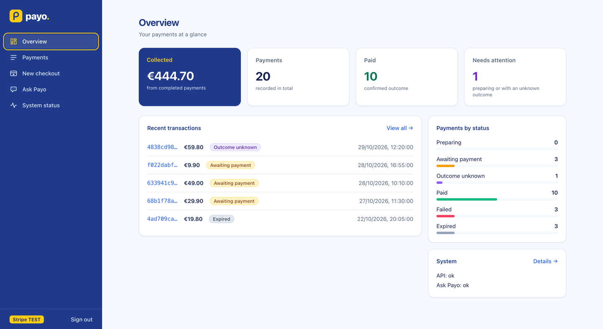
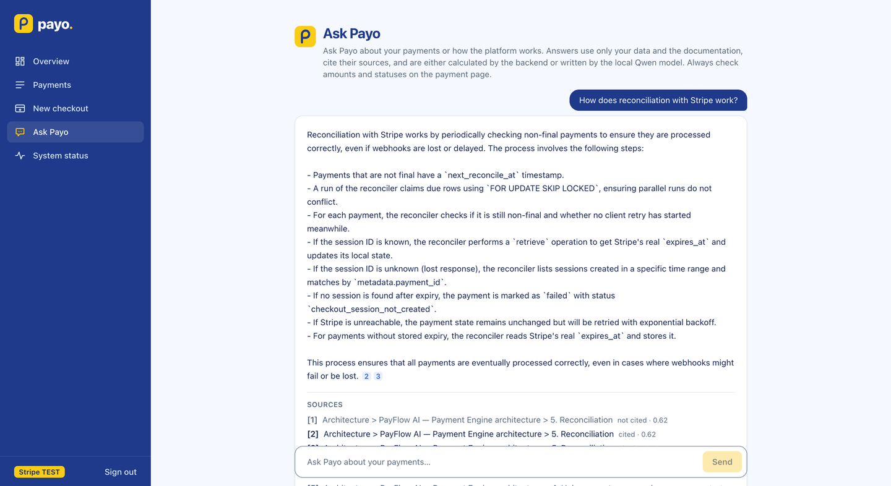

# PayFlow

A personal project focused on learning and exploring Artificial Intelligence.

PayFlow is a demonstration project I developed to explore the design and integration of AI-powered systems, with a particular focus on Large Language Models (LLMs), Retrieval-Augmented Generation (RAG) and text embeddings.

The project simulates a payment management platform with an AI assistant that lets users ask questions in natural language, in Italian or English, about their payment data and the platform's technical documentation. Questions about payments are answered from the database whenever possible; documentation and explanations are retrieved semantically and phrased by a local language model, with numbered citations to the sources it used.

The demo application is called Payo.

## Technologies and concepts

- **Local LLMs:** Qwen 2.5 (7B Instruct) running locally through Ollama.
- **RAG:** retrieval of relevant documentation and payment records, stored in a Qdrant vector database, as context for the model.
- **Embeddings:** multilingual semantic text representation with BGE-M3.
- **PostgreSQL:** structured data storage and SQL-based retrieval of amounts, statuses, counts and totals.
- **AI engineering:** integration of the language model with a FastAPI backend, a React dashboard and the application logic.
- **AI evaluation:** testing and measuring answer accuracy, reliability and consistency on synthetic question sets.

## Project goal

The goal of PayFlow is to gain hands-on experience in AI systems architecture, local language models, semantic search and the integration of artificial intelligence into practical software applications.

This project is intended for educational and demonstration purposes only. It uses synthetic data and is not designed for production use or real financial transactions.

## Screenshots

**Dashboard**

**Ask Payo**

## Documentation

Architecture, design decisions, setup instructions and evaluation results are in [`docs/`](docs/), starting from the [technical overview](docs/engineering/technical-overview.md).
