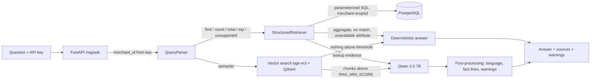

# PayFlow AI system

How the merchant assistant (`POST /rag/ask`) is built. This file is engineering documentation and is **not** indexed by the assistant (the indexer reads only `docs/*.md`). `docs/architecture.md` §8 describes the same system but is also part of the assistant's knowledge base: editing it changes retrieval, so changes there must be re-evaluated (see [evaluation](../quality/evaluation.md)).

## Components

| Component | Technology | Role |
|---|---|---|
| API | FastAPI (`backend/app/rag/router.py`) | Authentication by merchant API key, rate limit, request validation |
| Query parser | Python, deterministic (`app/rag/query_parser.py`) | Question → typed `QueryPlan` (intent + `PaymentFilters`) |
| Structured retrieval | SQLAlchemy on PostgreSQL 16 (`app/rag/structured.py`, `app/payments/repository.py`) | Merchant-scoped lookups and aggregates, derived facts |
| Semantic retrieval | bge-m3 via Ollama, Qdrant (`app/rag/service.py`, `qdrant_store.py`) | Documentation and payment documents by similarity |
| Generation | Qwen 2.5 7B Instruct via Ollama (`app/rag/ollama.py`) | Phrasing answers from numbered evidence |
| Post-processing | `app/rag/service.py`, `language.py`, `validation.py` | Language normalization of refusals, backend fact lines, answer warnings |
| Indexer | `app/rag/indexer.py` (`rag-indexer` service) | Incremental embedding of payments and `docs/*.md` |
| Evaluation | `app/rag/evaluation/` | 50 historical and 117 frozen generalization cases on synthetic data; per-case metrics, multi-run Markdown report |

## Data and trust boundaries

- **PostgreSQL is the source of truth** for payments (`payments`) and their history (`payment_events`). Amounts are integer minor units.
- **The tenant comes only from the API key.** `PaymentFilters` cannot carry a merchant (`extra="forbid"`); every repository query adds `merchant_id`; vector searches are filtered by scope `[merchant_id, "public"]` and re-checked in Python. A merchant id written in a question is ignored and the answer says so.
- **The LLM never writes SQL** and never sees data of another merchant.
- **Not indexed and never shown:** customer email, checkout URL, Idempotency-Key. Questions about them (and about name, phone, address, card data) get "found, but not available".
- **Retrieved text is untrusted:** it is fenced in a per-request random `<context-…>` tag; the system prompt tells the model to ignore instructions inside it.

## Models

| | Model | Why |
|---|---|---|
| Embeddings | `bge-m3` (1024 dims, multilingual, no task prefixes) | Italian questions on English docs: `nomic-embed-text` scored 0/6 on them, bge-m3 6/6 ([ADR 0002](../decisions/0002-multilingual-embeddings-bge-m3.md)) |
| Generation | `qwen2.5:7b-instruct`, temperature 0 | Local, no paid API. Not fully deterministic across runs even at temperature 0 |

Each embedding model has its own Qdrant collection (`<QDRANT_COLLECTION>__<model>`); the embedding signature (model, document prefix, collection) forces re-indexing when any of them changes.

## Configuration that changes behaviour

| Variable | Default | Effect |
|---|---|---|
| `OLLAMA_EMBED_MODEL` | `bge-m3` | Embedding model and collection |
| `RAG_MIN_SCORE` | `0.48` | Below this cosine score a chunk is not given to the model; calibrated for bge-m3 on the eval set |
| `RAG_TOP_K`, `RAG_MAX_DOC_CHUNKS` | 5, 2 | Context size; documentation cap on payment questions |
| `RAG_DOCUMENT_FACTS`, `RAG_SQL_LOOKUP`, `RAG_SQL_AGGREGATES` | `true` | Phases of the SQL-first design; switched off only to measure the baseline |

## Failure behaviour

| Failure | Behaviour |
|---|---|
| Ollama unreachable, timeout or HTTP error | `503 rag_unavailable` |
| Qdrant unreachable | `503 rag_unavailable` |
| PostgreSQL error on the SQL route | `503 rag_unavailable`, no internal details; error type logged |
| No evidence above threshold / no payment matches / metric not recorded / attribute not available | Deterministic answer in the question's language, no LLM call |
| Model refuses in another language | Replaced by the backend message in the question's language |
| Model answer without citations, with unknown ids, with amounts that do not match their role (threshold, aggregate, payment amount), or with an email | Answer kept, `warnings` returned to the client and shown in the dashboard |

The payment engine does not depend on the assistant: if Ollama is down, payments keep working.

## Related

- [Answer lifecycle](answer-lifecycle.md)
- [AI reliability](../quality/ai-reliability.md) and [evaluation](../quality/evaluation.md)
- [Decisions](../decisions/README.md)
